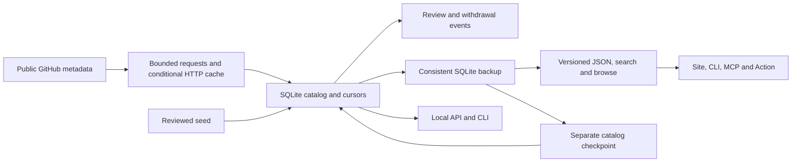

# ADR 013 · checkpointed catalog and source freshness

Status: accepted for the local M1 candidate, subject to owner review before publication. Date: 2026-11-26.

## Decision

Keep the existing SQLite catalog and API v1. New fields are additive. Freeze SQLite through its backup API at the start of export. Point web and public readers at one generation of immutable JSON. Derive freshness from last success and keep it distinct from the last attempt, what was covered and when the snapshot was generated.

Use the established project slug and PB-ID. A GitHub source key uses the stable old repository identity for verified renames and the original link for references. Numeric GitHub repository/user IDs, when present, corroborate identity. Fork identities remain distinct. A typed relation has endpoint keys, direction, reason, confidence and current review state. The curated ledger appends changes and withdrawals. Advice generated from source matching stays provisional.

The cloud build tries an independently retained checkpoint when its cache is missing, invalid or below public coverage. The candidate is checked against the previous public count. It preserves the previous publication if the count is unavailable or the candidate is smaller. The first recovery with no M1 checkpoint can resume from an existing full cache or a separately retained verified database. Recent public snapshots remain available during recovery.

## Alternatives and trade-offs

- A cache alone is simple to restore but may expire and cannot protect publication after loss.
- Reimporting arbitrary public JSON would lose cursor and transition data and would create a new trust boundary.
- A shared online database or a new runner adds operational work. SQLite backup, GitHub artifact retention and Pages satisfy the local recovery contract without a new service.
- Files from external sources are bounded and reduced to metadata. No arbitrary redirects, raw PR text, patch bodies, GitHub credentials or exchange database are included in checkpoints.

## Migration and rollback

At initialization M1 creates its additive tables and reconciles the reviewed seed. Original tables, PB IDs, source records and existing cursors stay readable. Schema changes add no destructive DDL. Back up an existing catalog before adopting M1. The 56e2262 runtime was used to create an evidence fixture, M1 read and exported it, and 56e2262 then read and exported the same database. For production rollback, restore the verified prior revision and publish using the existing approved workflow. Keep the M1 database copy for audit. [Runbook](../PASSIVE-MAINTENANCE.md#catalog-checkpoint-and-publication-guard--m1)

References: [SQLite backup API](https://docs.python.org/3/library/sqlite3.html#sqlite3.Connection.backup) · [GitHub API practices](https://docs.github.com/en/rest/using-the-rest-api/best-practices-for-using-the-rest-api) · [GitHub artifact access](https://docs.github.com/en/actions/how-tos/manage-workflow-runs/download-workflow-artifacts).

## По-русски

Текущая база SQLite и прежние адреса сохранены. Экспорт читает одну согласованную копию. Данные, время попытки и время публикации различаются. При потере кэша сборка ищет отдельную проверенную копию каталога. Пока покрытие падает, доступным остаётся предыдущий опубликованный снимок.
